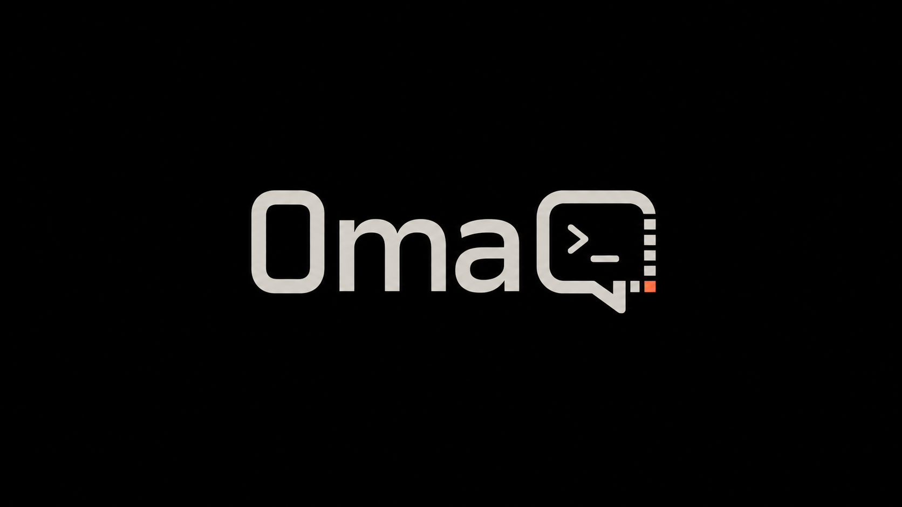
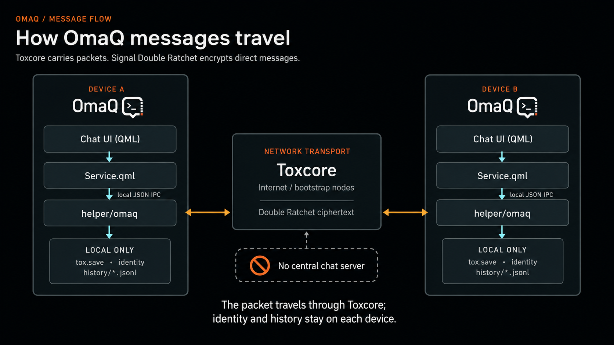
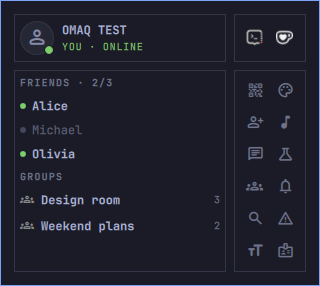
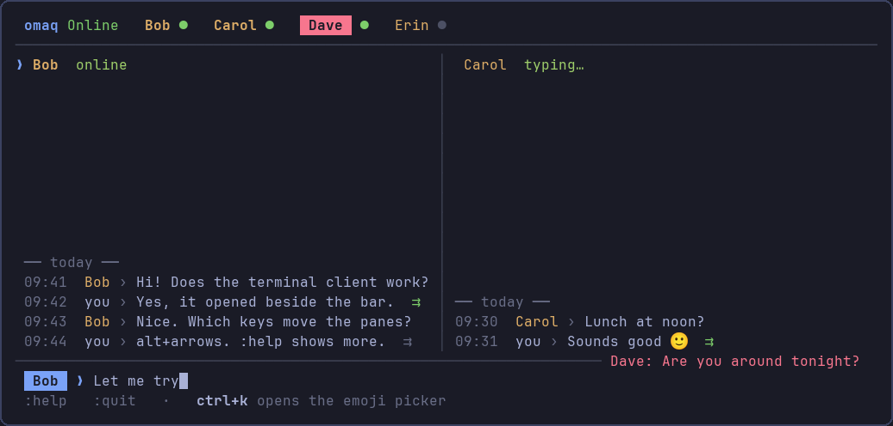

<h1 align="center">
  
</h1>

<p align="center">
  OmaQ is invite-only chat for the Omarchy bar: no account, phone number, or public user search. Create your identity locally, then connect with a one-time private invitation link or QR code.
</p>

## Security

Tox encrypts transport end to end, and direct text messages add the Signal Double Ratchet. OmaQ disables direct UDP discovery and hole punching, so contacts do not receive each other's IP addresses.

OmaQ runs no servers and has no operator access to your identity, contacts, or messages. Public Tox bootstrap and relay nodes can forward encrypted packets but cannot read message contents. Local filesystem permissions protect Ratchet state, avatars, receipts, preferences, and chat history that are not covered by the optional `tox.save` passphrase.

Use OmaQ only for lawful private communication with people you trust.

<details>
<summary>How OmaQ messages travel</summary>

<p align="center">
  
</p>

</details>

## Bar plugin and terminal client

<table>
  <tr>
    <th width="50%">Bar plugin</th>
    <th width="50%">Terminal client</th>
  </tr>
  <tr>
    <td align="center"><a href="docs/images/guide/01-panel-home.png"></a></td>
    <td align="center"><a href="docs/images/guide/38-terminal-overview.png"></a></td>
  </tr>
  <tr>
    <td valign="top">The panel in the Omarchy bar, with floating chat windows, notifications, groups, voice calls, images, reactions, and search.</td>
    <td valign="top"><code>omaq-connect</code> in any terminal, with direct chats in split panes, invitations, files, and emoji. <code>:help</code> lists every command and key.</td>
  </tr>
</table>

Use either one or both. They share one identity, contact list, and history.

The terminal client does not need the bar; it starts OmaQ's helper itself. To use only the terminal, run `omarchy plugin disable hancore.omaq` after installing. The updater needs the plugin enabled, so run `omarchy plugin enable hancore.omaq` before an update.

While the bar runs, quitting the terminal client changes nothing; a terminal-only session goes offline unless you belong to a private group. After updating an older installation, create the command once with `~/.config/omarchy/plugins/hancore.omaq/cli/omaq.py --link`.

## Install

```bash
omarchy plugin add https://github.com/HANCORE-linux/OmaQ.git --yes &&
~/.config/omarchy/plugins/hancore.omaq/install.sh --yes
```

`install.sh` installs dependencies, builds the helper, enables OmaQ in the bar, and creates the `omaq-connect` command. Pass `--section left` or `--section center` to change the bar section. Other Linux distributions are not supported yet.

If a successful install reports a current helper but OmaQ is still absent, refresh the shell:

```bash
omarchy restart shell
```

## Update

```bash
~/.config/omarchy/plugins/hancore.omaq/scripts/update-omaq.sh --yes
```

Do not update OmaQ with `omarchy plugin update`, including the all-plugins form. It updates the checkout without rebuilding the native helper. When needed, the updater builds outside the monitored plugin tree and verifies the result; the [installation lifecycle](docs/INSTALLATION.md) explains the details.

After an `activated` or `current` result, refresh the shell only if the interface has not reappeared:

```bash
omarchy restart shell
```

## Uninstall

```bash
~/.config/omarchy/plugins/hancore.omaq/scripts/uninstall-omaq.sh
```

It asks about each remaining OmaQ data directory, with No as the default; `--yes` keeps all data. It also removes the `omaq-connect` command. Dependency packages are never removed automatically.

<details>
<summary><strong>Project independence and lawful use</strong></summary>

OmaQ is general-purpose software intended for lawful use. This policy adds no restrictions to the open-source licenses.

The project answers lawful requests from public authorities truthfully, including when it does not possess the requested data. OmaQ operates no service and cannot provide identities, contacts, messages, or history stored only on your devices.

The project neither cooperates with resellers nor offers reseller, original equipment manufacturer (OEM), white-label, or exclusive distribution arrangements. This policy neither limits open-source redistribution rights nor implies project affiliation or endorsement.

OmaQ keeps one codebase and all security-relevant changes public and reviewable. The project offers no private, privileged, selectively weakened, or organization-specific builds, including for public authorities, companies, or resellers.

</details>

## Documentation

- [Illustrated user guide](docs/USER-GUIDE.md), including the [terminal client](docs/USER-GUIDE.md#chat-from-the-terminal)
- [Installation lifecycle](docs/INSTALLATION.md)
- [Security and privacy](docs/SECURITY.md)
- [Current status](docs/CURRENT.md)
- [Documentation index](docs/README.md)
- [Third-party components](THIRD_PARTY.md)

## License

The QML plugin is licensed under the [MIT License](LICENSE.MIT). OmaQ's helper source is GPL-3.0-or-later; the distributed helper binary is [GPL-3.0-only](LICENSE.GPL-3) because it also links to `libsignal-protocol-c`. See [Third-party components](THIRD_PARTY.md) for dependency and asset licenses.
